 

**I build AI systems that run on their own** — agents that make videos from a prompt, talk back in 11 languages, and run communities while you sleep. 
Everything below is open source, MIT-licensed, and built to be cloned and used today.

 

  

  

### Work with me

Need an agent, a content pipeline or a bot that just works? **[Open an issue on any repo](https://github.com/swarnasis154299/quickclip/issues/new)** or star the ones you'd use — every star tells me what to build next.

 

Every graphic on this page is hand-drawn SVG generated by <a href="scripts/build.py">scripts/build.py</a> — no templates, no third-party widgets. Stats refresh daily via GitHub Actions.

